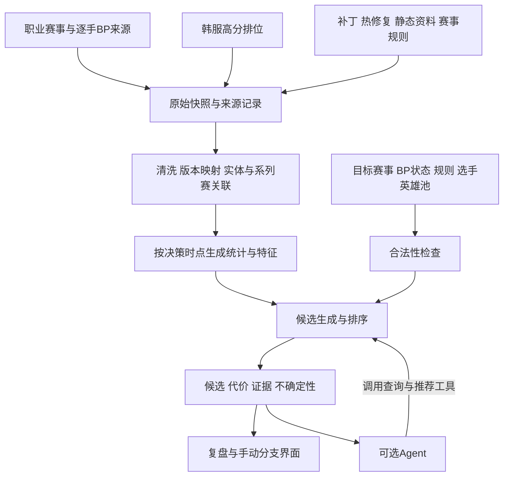

# LOL BP：v0.1 早期设计草案

- 编写日期：2026-10-28（Asia/Taipei）。
- 状态：早期设计，尚未实现或验收应用能力。
- 仓库：<https://github.com/fsyabc111/LOL_bp>。
- 目的：沉淀需求、来源调查和推荐方案，作为后续数据审计与实现讨论的起点。

本文不冻结技术框架、模型、评分权重、样本阈值或公开 API。本文中的流程、模块和字段均为设计建议，不表示已实现。

## 1. 决策状态与项目定位

### 1.1 已确认的范围

| 项目 | 当前约定 |
| --- | --- |
| 使用场景 | 职业赛事分析，关注 LPL、LCK 和全球总决赛（Worlds） |
| 用户与目标 | 自用，并逐步构建一个可运行、可解释的完整项目 |
| 首版核心体验 | 历史 BP 复盘与手动分支推演 |
| 数据成本 | 免费公开数据优先，接受缩小首批年份、赛段和样本范围 |
| 当前交付 | 早期设计文档、README 与 Git 仓库初始化 |

### 1.2 推荐设计

- 以版本感知的推荐引擎为核心，结合选手英雄池、当前选禁、阵容需求及系列赛规则。
- 纳入同版本韩服高分单双排，作为新补丁初期的候选发现和趋势参考。
- 提供多个候选及其收益、代价、样本依据和不确定性。
- 将 Agent 作为可选的工具查询与解释层；采集、统计、合法性检查和排序可独立运行。

以上是讨论形成的推荐方向；具体实现方式仍需在数据审计后确认。

### 1.3 暂不纳入首版

- 实时客户端接入、自动选禁、游戏内操作和对局实时指挥。
- 训练赛、队内战术、选手私有账号等非公开信息的获取。
- 职业教练能力替代、推荐必然提高胜率等效果承诺。
- 商业化、部署、付费数据采购及自动发布服务。

### 1.4 核心使用流程

选择比赛并载入双方首发、赛事补丁和规则，将 BP 停在某一步，查看当时可选英雄和多个候选方案。用户可以替换某一手，从该处创建分支并继续手动推演；每个建议都能展开查看数据依据与限制。

三个问题分别处理：预测对手可能选什么、推荐我方可考虑什么、评价当前或最终阵容。历史教练选择可以用于研究决策习惯，但不作为最优选择的真值。

## 2. 当前调查证据与数据来源

### 2.1 证据边界

2026-10-28 的前期对话已进行网络来源调查，读取部分网页、公开赛事目录及临时 CSV 样本；这些原始响应没有保存在本仓库。本文记录的是调查线索和单次观察，尚不是可复现的数据验收报告。

目前没有本地正式数据集、数据接入程序、通过认证的 Riot API 调用记录、采集调度或模型训练结果。页面可访问、HTTP 200、文档声明支持某字段，均不能单独证明数据完整或接口已接入。

后续审计应保留来源地址、获取时间、原始快照校验值、字段字典、覆盖统计和异常记录，并重新验证以下结论。

### 2.2 候选来源

表中的赛事覆盖表示找到相关入口或记录，不表示全部年份、阶段和字段完整。公开可浏览或下载，也不自动代表取得批量获取、再分发或商用许可。

| 来源与入口 | 已观察或文档声明的能力 | 获取方式及限制 | 当前定位 |
| --- | --- | --- | --- |
| [Leaguepedia](https://lol.fandom.com/wiki/League_of_Legends_Esports_Wiki) | LPL、LCK、Worlds 有专门的选禁顺序表，含补丁、比分和录像关联 | 网页与 [Cargo API 文档](https://lol.fandom.com/wiki/Help:Leaguepedia_API)；调查时 API 返回限流，部分页面只能经搜索索引查看；BP 表有人工录入内容 | 优先核验逐手 BP；尚未验收稳定读取与完整率 |
| [Oracle's Elixir](https://oracleselixir.com/tools/downloads) | 官网前端指向的年度目录列出 2014–2026 年 CSV；提供主要职业赛事统计 | [年度文件目录](https://drive.google.com/drive/folders/1gLSw0RLjBbtaNy0dgnGQDAZOHIgCe-HH)可列出文件；本次未完成原始年度文件的逐字段验收 | 候选统计主源；需逐年核查赛事覆盖、空值、选禁语义及使用条件 |
| [Games of Legends](https://gol.gg/tournament/list/) | 已读取三项赛事的 2025/2026 页面及单局样例；有补丁、阵容、先选标识、选手表现和分局导航 | 免费网页，部分高级功能付费；未确认公开批量导出或对外 API；英雄显示排列不能直接认定为选取顺序 | 人工浏览、统计核对和异常排查 |
| [ChainCC](https://chaincc.lol/free/data) | 提供 2014–2026 年 players/teams 压缩 CSV；临时读取过 2026 文件 | 无需账号或 Key；页面声明 CC BY 4.0；[方法说明](https://chaincc.lol/about/methodology)列有 OE、Leaguepedia 等上游，仍需核查适用条件 | 便捷补充源；发现分类及系列赛字段问题，不能直接当作已清洗事实库 |
| [GPTilt 比赛数据](https://huggingface.co/datasets/gptilt/lol-esports-matches) | 数据卡提供 games、matches、tournaments，包含 match_id、best_of、game_number；声明定期同步 Leaguepedia | Parquet/HF datasets，声明 CC BY-SA 3.0；英雄列表明确按最终分路排序；样本覆盖仍需按目标赛事统计 | 补比赛与系列赛关联；不能替代逐手选取顺序 |
| [GPTilt 实体数据](https://huggingface.co/datasets/gptilt/lol-esports-entities) | 选手、队伍及别名关联 | 当前快照不能直接表示历史转会及首发状态 | ID 与别名归一候选 |
| [Liquipedia](https://liquipedia.net/leagueoflegends/Main_Page) | 三项赛事有赛事、赛制及统计入口 | API 访问级别和 [使用条款](https://liquipedia.net/api-terms-of-use)需核查；不能预设可免费批量抓取 HTML | 赛事结构、规则与名单补充 |
| [LoL Esports 官方](https://lolesports.com/en-US/leagues/worlds%2Clck%2Clpl) | 三项赛事的赛程、阶段、BO 类型、结果和录像入口 | 未确认面向第三方的历史全量导出 | 赛事身份、比分及录像核对 |
| [腾讯赛事官网](https://lpl.qq.com/es/data/) | [公开赛事目录](https://lol.qq.com/act/AutoCMS/publish/LOLWeb/EventdataTab/EventdataTab.js)列出 2016–2026 年 LPL 及部分世界赛等入口，未发现 LCK 独立联赛目录 | 目录可读不代表逐局字段完整；部分页面访问不稳定；未确认对外下载/API 文档 | LPL、Worlds 官方核对来源 |
| [玩加电竞](https://www.wanplus.cn/lol/event) | 有三项赛事页面、历史年份入口、比分、分局导航和聚合统计 | 抽查详情显示数据上传中，详情请求未取得有效 JSON；未确认批量下载及 BP 顺序 | 中文赛程与统计补充 |
| [OP.GG Esports](https://esports.op.gg/) | 导航有 LPL、LCK、Worlds；QWER.GG 已跳转至此 | 部分表格提取为空，逐场 BP、历史边界及导出未验证 | 待核验的展示参考；两个域名不计为两个独立来源 |
| [DPM.LOL](https://dpm.lol/esports) / [RFT.GG](https://rft.gg/) | 有赛事、系列赛、分局、英雄及表现展示；两站存在运营和数据链关联 | [DPM 条款](https://dpm.lol/tos)和 [RFT 条款](https://rft.gg/terms)限制未经许可的自动查询及抓取 | 人工参考或取得相应许可后使用 |
| [GRID](https://grid.gg/data/games/league-of-legends/) | 官方说明提供历史/实时选禁与选取顺序等 | 普通 [Open Access](https://grid.helpjuice.com/3673199)不含 LoL；具体 LPL/LCK/Worlds 覆盖和用途按授权确认 | 后续授权渠道，不作为已取得的免费数据 |
| [PandaScore](https://www.pandascore.co/league-of-legends) | 官方说明覆盖三项赛事，提供文档化 API | [权限表](https://developers.pandascore.co/docs/plan-reference)区分免费赛程结果与详细比赛统计套餐；未做账号调用或 BP 顺序验收 | 备选服务，当前不采购 |

Bilibili 赛事数据中心、Score/伐木累、Factor.gg 本次存在空页面、访问限制或超时，暂不作为主数据源候选。

逐手 BP 可从这些代表页面开始复核：[LPL 2026 Split 2 Playoffs](https://lol.fandom.com/wiki/LPL/2026_Season/Split_2_Playoffs/Picks_and_Bans)、[LCK 2026 Rounds 1–2](https://lol.fandom.com/wiki/LCK/2026_Season/Rounds_1-2/Picks_and_Bans)、[Worlds 2025 Main Event](https://lol.fandom.com/wiki/2025_Season_World_Championship/Main_Event/Picks_and_Bans)。调查时主要经搜索索引确认表结构，程序读取尚未验收。

Games of Legends 的赛事样例为 [LPL 2026 Split 3](https://gol.gg/tournament/tournament-stats/LPL%202026%20Split%203/)、[LCK 2026 Rounds 1–2](https://gol.gg/tournament/tournament-stats/LCK%202026%20Rounds%201-2/)、[Worlds 2026 Main Event](https://gol.gg/tournament/tournament-stats/Worlds%202026%20Main%20Event/)。这些页面适合核对已展示统计，仍需验证逐场字段与来源关联。

### 2.3 已发现的具体质量问题

1. **赛事标签可能混合资格赛与正赛。** 临时读取的 [ChainCC 2026 teams 文件](https://chaincc.lol/data/chaincc-teams-2026.csv.gz)按标签有 LPL 674 小局、LCK 502 小局、WLDs 63 小局；只是文件记录数，不代表完整比赛总量。WLDs 中包含 2026-09-17 IG 对 TES，官方赛程将其列为 LPL Regional Qualifier，因此不能直接把 WLDs 当作世界赛正赛。可复核记录为 `13506-13506_game_1`。
2. **系列赛字段存在空值。** 上述样本中三个目标赛事的 bo_format、match_in_series、game_in_match 列为空；仅有 game_number 不足以验收系列赛关联。
3. **pick 列不一定表示选取顺序。** GPTilt 明确按上、野、中、下、辅排列英雄。ChainCC 的 pick1–5 与最终分路并非整体一致，但尚未完成录像逐手核对，不能据此判定顺序正确。
4. **来源可能共享上游。** ChainCC 与 GPTilt 使用 OE 或 Leaguepedia，展示站也可能共享数据。多个页面一致不能自动视为独立验证。
5. **历史公告不代表当前状态。** [OE 公告](https://lol.timsevenhuysen.com/category/news/)曾报告 2026 年先后选解析问题，并更新称已修复；另在 7 月报告 LPL/LDL 数据源中断。当前文件恢复范围和遗留缺口仍需实查，不能沿用旧公告或其他项目的旧说明判断当前可用性。

### 2.4 推荐的首次数据审计

从一个可取得稳定样本的赛段开始，同时选择 LPL、LCK、Worlds 的代表性比赛检查跨来源关联。抽取约 30 场可作为流程验证起点，此数量不是统计充分性的阈值。

检查赛事与阶段身份、系列赛/小局关联、首发与最终分路、目标补丁、地图边、先后选、全部选禁步骤及全局 BP 已消耗英雄。保留冲突和缺失记录，不通过猜测补齐事实。主源、备用源和首批覆盖范围在审计后决定。

## 3. 版本感知设计

### 3.1 每次分析绑定目标环境

- 目标赛事、赛段、实际比赛补丁与规则版本。
- 决策时点和允许使用的数据截止时间。
- 原始资料的获取时间、资源版本、处理版本及模型/规则版本。
- 必要时区分热修复前后，并核实热修复是否应用于该赛事环境。

赛事补丁不一定等于当前排位补丁。例如官方将 [26.20](https://www.leagueoflegends.com/en-us/news/game-updates/league-of-legends-patch-26-20-notes/)标为世界赛补丁，之后又发布了 26.21；分析该赛事不能自动使用后续版本数据。公告、API 和资源版本的命名可能不同，应保留原值及经核实的映射，不能仅凭字符串或日期推断。

历史复盘使用当时可知资料；按新版本重新评价旧阵容应明确标记为跨版本推演，不能表述为对原比赛决策的还原。

### 3.2 将变更事实与影响判断分别保存

| 层次 | 建议记录 | 状态与用途 |
| --- | --- | --- |
| 变更事实 | 英雄/装备/符文/系统、旧值与新值或机制描述、模式、补丁、发布时间、生效信息、来源及修订 | 以官方公告、热修复和版本化资料为依据；只读取职业赛适用的召唤师峡谷内容 |
| 影响判断 | 受影响英雄、位置、打法与依赖关系，影响方向、理由、置信程度、判断者及复核状态 | 属于可修订的人工/模型假设，不能当作官方事实 |
| 实际观察 | 同版本职业与排位样本的使用、选禁、表现和不确定性 | 用于验证判断；观察到变化不等于证明因果 |

版本影响覆盖直接英雄调整、装备与符文依赖、对手变化，以及地图资源、经济和经验规则变化。未被直接改动的英雄也可能受到间接影响。

例如 26.20 火箭腰带减少技能急速、提高主动伤害，不能简单归为对所有使用者相同幅度的增强或削弱。可以关联常用该装备的英雄与构筑，生成待验证的影响判断，不直接换算为固定胜率增益。

[Data Dragon](https://developer.riotgames.com/docs/lol#data-dragon)提供版本化静态资料，但官方说明其更新可能滞后；它与[补丁公告](https://www.leagueoflegends.com/en-us/news/tags/patch-notes/)互相补充，不构成完整的游戏机制模拟器。

### 3.3 历史信息按特征迁移

- 选手英雄经验可保留较长历史，同时考虑近期使用、转会和位置变化。
- 英雄选禁优先级更强调目标补丁及近期职业观察。
- 对位与组合统计需检查相关英雄、装备和系统的变化，避免只看补丁距离。
- 阵容功能标签由可复核的资料维护，机制变化后重新评估。
- 大幅重做、新英雄和系统更新属于高不确定性情形，降低旧经验的影响并显式提示。

推荐采用本版本证据与折扣后的历史经验融合，并随证据质量更新。权重、回退范围和样本门槛通过时间回测确定；不预设“增强一次加若干分”之类已被验证的规则。

## 4. 韩服高分单双排参考

### 4.1 作用与边界

拟纳入同版本韩服高分单双排，用于发现英雄位置变化、使用趋势、构筑和前期表现信号，补充新补丁初期职业样本不足的问题。它对职业阵容协作、针对性 Ban 和全局 BP 的迁移能力仍需验证。

职业数据与排位数据分别保留来源类型、统计样本和可信度，不能混在一起计算一个通用胜率。大量排位对局不能仅凭数量压过更贴近目标场景的职业证据。

### 4.2 采集建议

候选路线是韩服高分排行榜账号、PUUID、最近单双排比赛、比赛详情，必要时补时间线。官方有 [League/Match API](https://developer.riotgames.com/apis)，[路由文档](https://developer.riotgames.com/docs/lol#routing-values)列有 KR 与 ASIA；具体接口字段、访问范围和凭证可用性需通过后续安全样例调用验证。

API Key 由运行环境管理，不进入仓库或前端；采集应缓存、增量更新、遵守限流及错误退避。[开发者说明](https://developer.riotgames.com/docs/portal)区分开发、个人和生产访问，不能假定开发 Key 可持续运行公开服务。

初期可评估以王者/宗师账号为种子，再按覆盖需要扩大到大师。实际段位边界、观察窗口、更新频率和采样规模尚未确定。

### 4.3 必须记录和处理的问题

| 问题 | 推荐处理 |
| --- | --- |
| 高分定义 | 明确是高分种子账号参与的对局，还是要求更多参与者满足条件；一名王者在场不代表十名玩家都是王者 |
| 段位时点 | 保存段位、排名、快照获取时间和种子纳入原因；当前段位不能回填为历史比赛时段位 |
| 去重 | 按比赛 ID 去重，保留从哪些种子发现，避免同一局被多名账号重复计数 |
| 玩家集中度 | 同时报独立账号数、样本集中度及单账号贡献；评估降权或贡献上限，防止绝活玩家主导 |
| 版本与模式 | 保留比赛原始版本、时间和队列，仅按确认的目标版本、模式纳入；热修复边界未知时保留标记 |
| 异常样本 | 检查重开、异常时长、缺失数据；清洗规则需记录版本并保留排除计数 |
| 分路 | 检查位置字段和推断可靠性；未知或冲突分路单独处理，不强行构造对位 |
| 身份映射 | 若研究职业选手公开账号，只采用有可靠公开证据的关联，未知账号不猜测身份 |

### 4.4 信号及融合方式

优先计算分位置使用率变化、平滑后的胜负表现、独立使用者分布、构筑变化，以及可取得的历史前期经济/经验/补刀表现。描述趋势时同时展示样本量、时间窗口和不确定性。

候选方案是在职业历史基线之上，使用补丁信息和同版本排位变化修正候选关注度，再用本版本职业比赛继续验证。排位信号的影响按任务和数据质量决定，不能只根据职业场次数量机械增减。

需要分别评估：新英雄/新分路的候选发现、已有候选的优先级修正、对位与组合判断。构筑胜率还可能受玩家水平、经济和存活时间等选择偏差影响，不能直接解释为装备的因果收益。

排位战绩的最终阵容不能当作完整 BP 序列。[Riot 问题追踪](https://github.com/RiotGames/developer-relations/issues/739)中存在请求返回选取轮次的记录；具体当前字段仍需验收，不能用排位数据替代赛事逐手 BP。

## 5. 推荐架构与模块边界

### 5.1 责任划分

| 模块 | 责任与最小能力 |
| --- | --- |
| 来源接入 | 按各来源约定增量读取，保存原始响应、获取记录、失败与限流状态 |
| 数据规范化 | 保留原始 ID，建立英雄、选手、队伍、补丁、赛事、系列赛和小局关联；冲突不能静默覆盖 |
| 版本与知识维护 | 管理事实、影响假设、来源修订、有效时间和复核状态 |
| 统计与特征 | 在数据截止时间内计算，分别保留职业和排位样本；同一局不重复计数 |
| BP 状态与规则 | 根据赛事规则生成下一行动和合法候选，管理地图边、先后选、阶段及跨局消耗 |
| 候选与评价 | 从合法集合生成多个选择，结合版本、英雄池、阵容与对手信息排序并说明代价 |
| 证据展示 | 展示来源、统计范围、样本量、缺失与不确定性，支持用户查看和修正假设 |
| 交互与可选 Agent | 复盘、分支、候选比较；Agent 调用同一套查询与分析能力 |

### 5.2 概念数据与接口需求

这里只定义能力与概念记录，不冻结数据库表、HTTP 路由或传输格式。

- **赛事、系列赛与小局**分别建模。一个系列赛包含多局比赛，保留阶段、BO 类型、首发、补丁、日期和结果的来源。
- **BP 事件**保存行动先后、行动队伍、禁用/选择、英雄及其来源；最终分路单独保存，不能反推为当时已知位置。
- **地图边与先后选**分别保存。Riot 的 [2026 First Selection 说明](https://lolesports.com/en-AU/news/season-start-2026-lol-esports)明确二者可以分离，不能默认蓝色方先选。
- **规则配置**绑定适用赛事与时间，覆盖选禁顺序、普通禁用、系列赛已用英雄、赛事禁用及重开等处理；不同规则不得套用同一全局 BP 假设。
- **分析请求**表达目标补丁、决策时点、规则、双方选手、当前已知 BP、此前小局及用户明确提供的假设。
- **候选结果**包含英雄或行动、排序依据、收益与风险、统计样本与来源、证据不足提示；启发式分数不显示为未经校准的胜率。
- **证据记录**关联来源原值、获取时间、比赛/步骤定位、处理版本、事实或推断类型，支持追溯。

最小能力包括载入比赛、按步骤回放、校验状态、查询补丁与统计、比较候选、创建和继续分支。非法或信息矛盾的 BP 状态应要求修正，不能自行补出不存在的历史事实。

### 5.3 推演与信息边界

替换历史某一手后，从该点建立新分支。原比赛后续选禁保留为参考，不假定对手在新情境下仍采取原行动。首版后续行动由用户手动输入；自动对手策略和多步搜索属于后续研究。

摇摆英雄保留多个可能位置。历史推荐不能看到后续锁定英雄、最终分路、当前小局赛后表现或比赛结果；此前已结束小局的数据可按当时可知范围使用。

### 5.4 Agent 的可选职责

固定的数据同步、统计和规则校验使用确定的程序流程。Agent 可根据问题组合查询补丁、职业统计、韩服趋势和候选比较，再组织解释。

大模型可以生成补丁结构化草稿或影响假设，但事实入库前需要校验。Agent 不直接改写原始比赛事实、统计数值或已发布权重；解释引用工具结果，并标注假设、冲突和信息不足。关闭 Agent 后，核心推荐和复盘仍应可用。

## 6. 评估与验收设计

### 6.1 数据与功能

- 样例 BP 与原始赛事记录/录像逐手一致，地图边、先后选、局序、全局消耗正确。
- 能从原始来源追溯派生记录，重复比赛不会放大样本，缺失与冲突可见。
- 合法性检查覆盖已选、已禁、系列赛消耗、赛事禁用及行动阶段；代表性非法选择必须被拒绝。
- 分支状态与原记录分离，回退、重新选择和继续推演结果一致。
- 历史分析使用当时补丁与资料截止时间，不读取之后的比赛或修订信息作为当时证据。

### 6.2 推荐基线与对照

先建立版本热门推荐、选手近期常用英雄推荐，再比较以下候选系统：

1. 职业历史数据基线。
2. 基线加入目标补丁的职业统计与版本处理。
3. 再加入结构化补丁影响判断。
4. 再加入同版本韩服高分排位信号。

上述顺序用于消融比较，不表示每一层必然有效。保留没有改善或变差的结果，不通过增加 Agent 数量解释效果。

### 6.3 时间回测与结果解释

- 采用按时间滚动的训练/验证/测试；同一系列赛不跨数据划分，调参与统计不能看到测试未来。
- 重点比较补丁初期、首周和样本积累后的阶段；具体窗口在实验设计时确定。
- 记录目标补丁、数据快照、清洗规则、模型版本与随机性配置，使结果可复现。
- 没有历史段位或资料快照时，不能用今天的数据伪造当时信息；相关回测必须降级、排除或明确限制。
- 历史选择的 Top-K 命中率反映对职业习惯的拟合，不证明推荐最优。结合盲评、候选合理性、证据正确率及误推荐案例评估。
- 若未来预测胜率，另外报告校准与队伍实力等基线；预测准确率不等于 BP 推荐效果，更不证明选择造成胜率提升。
- 原始样本数与独立比赛、系列赛、玩家覆盖分别报告，考虑相关性，不能只用总行数衡量充分性。

## 7. 推荐阶段与完成条件

所有阶段均为计划，除文档建立外尚未启动。

| 阶段 | 交付 | 完成条件 |
| --- | --- | --- |
| P0 数据审计 | 有版本标识的代表样本、覆盖与缺失报告、来源映射 | 验证逐手 BP、系列赛关联及补丁；明确可用主源与缺口 |
| P1 复盘与手动推演 | 比赛加载、逐手回放、规则检查、分支 | 选定样例可正确重放，非法状态被阻止，分支不污染历史 |
| P2 推荐基线 | 热门/英雄池基线、多个候选与证据 | 输出可复核，完成时间划分与代表案例评审 |
| P3 版本与韩服信号 | 变更档案、排位采样与独立统计、融合实验 | 比较新增信号的收益和误推荐，明确冷启动适用范围 |
| P4 可选 Agent | 工具查询、复杂问题分析与解释 | 结果引用工具证据；核心能力可独立运行，解释质量单独验收 |

## 8. 风险与待决事项

### 8.1 主要风险

- 来源访问和使用条件变化、限流、数据停更或无法追溯历史修订。
- 选禁缺失、赛事误分类、跨源 ID 不一致及同上游数据造成的虚假互证。
- 组合样本稀疏、版本漂移、队伍实力与玩家选择偏差，以及排位到职业环境的迁移误差。
- 公开比赛无法揭示训练赛、临时战术和选手状态，系统结论存在信息上限。
- 大模型可能错误解读补丁或给出无依据解释，需事实与假设区分、工具证据和人工复核。

### 8.2 后续需要确认的决策

- 首批联赛/赛段/年份、主备数据源，以及适用条款和稳定访问方式。
- 韩服采样范围、更新周期、观察窗口、段位与玩家集中度处理。
- 补丁影响判断的审核方式、标签维护及历史资料修订策略。
- 推荐目标与人工评审标准，采用的模型、权重、样本门槛和回退策略。
- 本地存储、后端、界面及部署技术；是否需要外部大模型与成本边界。

后续实现前应按阶段确认这些事项，不能将待决项视为既定约定。

## 9. 当前仓库与开发约定

当前仅创建 README 与本文，不初始化应用、不安装依赖、不落盘采集数据。后续原始数据、账号映射、凭证、缓存和运行产物的存放与版本管理策略需另行确定，API Key 不得进入提交。

开发遵循小步提交、及时推送：按有意义的功能、修复和评审结果提交，不为凑次数拆分；只提交当前任务文件，检查敏感信息，推送后核对本地/远程 SHA 与工作区状态。推送不代表合并或发布，当前明确的只读、不提交或不推送指令优先。
